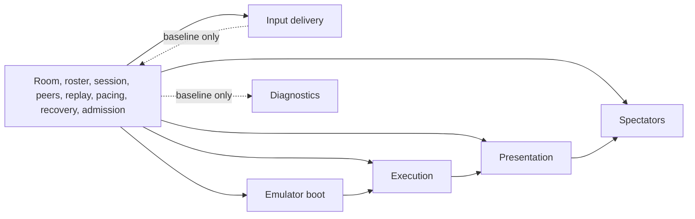

# Axiomatic design

[Functional requirements](functional-requirements.md) · [Design parameters](design-parameters.md) · [Design matrix](design-matrix.json) · [Netplay invariants](../netplay-invariants.md)

## Scope and method

The baseline is [`a1bf02c98bf427ab5d1f7a053ae42d027bbf35ed`](https://github.com/kwilson21/kaillera-next/tree/a1bf02c98bf427ab5d1f7a053ae42d027bbf35ed). The matrix covers room and match behavior in rollback, lockstep, and streaming modes, along with watching, presentation, and match diagnostics. Recent fixes for retained prediction history, replay preemption, join input agreement, and saved returns are part of the baseline. [PR #330](https://github.com/kwilson21/kaillera-next/pull/330) · [PR #332](https://github.com/kwilson21/kaillera-next/pull/332) · [PR #334](https://github.com/kwilson21/kaillera-next/pull/334) · [PR #341](https://github.com/kwilson21/kaillera-next/pull/341) · [PR #344](https://github.com/kwilson21/kaillera-next/pull/344)

Suh's Independence Axiom asks whether an FR can be maintained while adjusting another FR's design parameter. In the binary approximation `FR = A × DP`, mark a 1 when a DP owns a decision that changes an FR's satisfaction, such as an authority change, a frame gate, or a cross-boundary mutation. Routine imports, shared infrastructure, and moving values across interfaces are excluded. A necessary edge expresses a behavior required by the current protocol or simulation constraints. An accidental edge expresses incidental interference that can be eliminated while preserving the contract. A zero means no such dependency was identified at this granularity. [Nam Pyo Suh, MIT 2.882](https://web.mit.edu/2.882/www/chapter1/chapter1.htm)

## Independence Axiom

| Metric | Baseline | v0.73.5 |
| --- | ---: | ---: |
| FRs × DPs | 14 × 14 | 14 × 14 |
| Nonzero entries | 50 | 48 |
| Cross-dependencies | 36 | 34 |
| Declared accidental entries | 2 | 0 |
| Strongly connected components | 6 | 7 |
| Largest strongly connected component | 9 | 8 |
| Classification | Coupled | Coupled |

The checker first attempts a perfect bipartite FR/DP matching. The declared counterparts form a perfect match here. After contracting each matched pair, an edge points from the matched DP's FR to the FR it also affects. A topological order gives a lower triangular form. A nonsingleton strongly connected component gives an alternating cycle in the original matching, so multiple perfect matchings exist. A triangular matrix with a nonzero diagonal has a unique perfect matching. Therefore changing the row/column assignment cannot triangularize either snapshot.

The final component contains admission, pacing, peers, recovery, replay, room, roster, and session. Delivery leaves that component when its close handler stops resetting the simulation clocks. The other singleton components are boot, execution, presentation, spectators, and diagnostics. This condensation graph uses one node per component. The full directed graph and both binary matrices are available from the checker.



## Coupled boundaries

| Boundary | Observed constraint and ownership |
| --- | --- |
| Rollback and resynchronization | C owns pending rollback and replay. JavaScript stages and validates host snapshots. A successful native write can supersede replay after the bounded wait and before frame alignment and input settlement. |
| Reconnect and prediction | Identity and primary attempt changes reach `resetPeerState`. JavaScript clears its live frontier, while C can keep a safe same-owner slot and its predictions. A replacement owner or unsafe phantom history requires a reset. |
| Late join and frame progression | The host publishes one pause and serves per-joiner leases. It resumes once each applicable serve ends. The joiner attaches a state, input bridge, and roster to the same host frame. Guest-side expiry gives a missing host pause a bounded release. |
| Transport failure and recovery | A primary outage affects identity and answer debt. The recovery actor tracks delivery by recipient. The optional channel can disappear while reliable delivery continues. Letting that event mutate the simulation wait gave it an unrelated release decision. |
| Roster and history | Server seat reservations authorize a player. The host's frame-tagged cut defines when the simulation changes ownership. A late cut triggers local rerun where the ring can supply the history, or resync where it cannot. |
| Restoration and pending replay | `kn_set_frame` refuses a frame change during pending replay. The state apply path checks the resulting frame, blocks normal execution on a refusal, then aligns the JavaScript mirror and publishes settlement. `KNState.frameNum` is a page projection. It must never become a competing simulation clock. |
| Host, spectators, and players | Server room ownership and a lease determine whether the match survives. The native host supplies snapshots and spectator media. Streaming host departure also removes the sole running emulator. The spectator role receives media without gaining controller authority. |
| Deadlines, pacing, and ticks | Tick entry credits a local freeze before servicing deadlines, including coordinated host capture. A blocked frame still needs scheduling opportunities for repair work. Late-join serving and page boot have their own integration points and bounded waits. |

## Findings and direction

1. **P2 · Optional input-channel close rewrote the simulation wait.** The close handler could reset a wait for another player while their primary channels stayed open. The production-handler regression and `optional_input_close` in [tick_deadlines.qnt](../../specs/tick_deadlines.qnt) cover the fix. [PR #345](https://github.com/kwilson21/kaillera-next/pull/345)
2. **P2 · Session teardown could lose the tail of a diagnostic upload.** Document exit now hands off the newest buffered tail in one bounded keepalive request. Acknowledgements still govern the live drain. The browser regression closes the document with a delayed collector. [PR #349](https://github.com/kwilson21/kaillera-next/pull/349)
3. **P3 · Full peer reset could extend another slot's input wait.** A reset now clears only the affected slot's wait. The room's host-reservation policy can still gate frame progression, so this narrows the existing peer-to-pacing entry. The production-path regression and Quint's `otherWaitsStayArmed` cover the two-blocker case. [PR #350](https://github.com/kwilson21/kaillera-next/pull/350)

The follow-ups on v0.73.5 preserve pending replay through a refused native write, preserve buffered diagnostics when optional native counters fail, and fence obsolete admission and roster messages by serve and channel. The diagnostics failure was outside the declared 48 current cells. The roster and recovery relationships still carry necessary authority. [PR #351](https://github.com/kwilson21/kaillera-next/pull/351) · [PR #352](https://github.com/kwilson21/kaillera-next/pull/352) · [PR #353](https://github.com/kwilson21/kaillera-next/pull/353) · [PR #354](https://github.com/kwilson21/kaillera-next/pull/354)

### Recovery and pacing independence

The v0.73.5 frame loop both services generic guest resync request deadlines and credits gaps in its own ticks to those request clocks. The acceptance test varies frame scheduling while keeping recovery inputs fixed. Retries and give-up must follow the same timeline, and snapshot install must still wait for a safe frame boundary.

The candidate gives numbered generic requests a recovery-owned browser timer. Its production-path test retries at 8 and 16 seconds and gives up at 24 seconds with either regular or absent frame ticks. The v0.73.5 stopped-frame case never retries. Quint records the historical violation and bounded fixed property. The matrix cell remains for coordinated capture, installation and other recovery clocks that still depend on the frame loop. An asynchronous host transfer could read an intermediate snapshot between replay slices. The candidate checks native replay ownership at the actual read boundary. The production-path regression and Quint’s `onlyStableSnapshots` property cover this ordering. A delayed-answer run showed that a late input could also invalidate a snapshot during compression. The candidate checks the original capture watch before the first wire byte. Quint’s `onlyCurrentSnapshotsStart` property covers invalidation during compression and queueing. Two subsequent real-ROM runs matched all 3,073 and 2,910 compared battle frames. Recovery still depends on replay for snapshot validity, and a transfer already started can still require a follow-up. [PR #355](https://github.com/kwilson21/kaillera-next/pull/355)

## Verification

- The close-handler regression fails in both transport modes on the baseline. Both pass after the fix. Quint's corrected model holds through 12 steps in Apalache. The historical model produces a counterexample within three steps. The complete 491-command recorded simulation run exercises the repository's existing reconnect, replay, roster, late-join, and recovery models as well.
- On local Chrome with SSB64 US and 50 ms latency plus 20 ms jitter, two, three, and four players matched all compared gameplay and game-state hashes across 1,263, 983 per guest, and 667 per guest finalized battle frames, respectively. Late-join and spectator lifecycle checks passed. The third-player admission test observed progression and one transient stranded-wait diagnostic. It does not measure hash agreement at admission.
- Later real-ROM tests confirmed reconnect recovery, retained prediction, and finalized hash agreement for each guest in three- and four-player admission, including a signaling drop. The 55-second lockstep comparison for the per-slot fix measured 58.3 baseline and 58.2 candidate FPS per peer at the same effective delay, with zero gameplay or game-state hash mismatches. [PR #347](https://github.com/kwilson21/kaillera-next/pull/347) · [PR #348](https://github.com/kwilson21/kaillera-next/pull/348) · [PR #350](https://github.com/kwilson21/kaillera-next/pull/350)
- In a separate baseline–fixed–fixed–baseline two-player run using the same 18-second battle window and light diagnostics, baseline rates were 47.1/46.7 and 47.8/48.0 frames/s (host/guest). Fixed rates were 51.0/50.9 and 50.0/50.5. All four runs passed their hash comparison. This small local sample did not show a throughput regression. Browser scheduling and randomized match inputs limit the comparison. It does not establish a speedup or cover Windows hardware.

## Information Axiom

Information content is `I = −log₂(P(success))` for a defined success event under a defined operating distribution. A joint success probability is needed for correlated FRs. Scenario passes, matching frames within the same match, formal model checks, and a small number of local runs are correlated or selected evidence. There is insufficient evidence for a product success probability or information-content score. For a comparison, predefine success per match (for example, all peers advance, recover within their declared deadline, and agree on finalized frame hashes), sample independent matches across defined network and device conditions, and report denominators and uncertainty. [MIT Axiomatic Design introduction](https://web.mit.edu/axiom/www/introduction.shtml)

## Maintain the matrix

```sh
node scripts/check-design-matrix.ts --base origin/main
node scripts/check-design-matrix.ts --json
```

The manifest stores the pinned baseline and explicit additions and removals. Each nonzero entry declares its mechanism, necessity, source anchor with recorded line, and behavioral test or spec. The checker validates IDs, duplicates, evidence path and anchor existence, endpoint coverage through matching, and strongly connected components. It resolves current evidence line numbers in JSON output. Architectural intent, coverage adequacy, and independence of unlisted relationships require review. A source symbol or test file existing only establishes traceability.

The existing CI JavaScript job checks the manifest against the PR base, reports added cross-dependencies, and rejects newly declared accidental coupling. Necessary cross-dependencies still require a mechanism and evidence. The checker does not infer dependencies from code edits. When changing owners or time boundaries, update the affected entries and tests in the same PR.
