# Demo run-state machine

Generated from `web/src/demo/run-state.ts` by `node scripts/demo-run-diagram.mjs`. Do not edit by
hand; `npm run check` fails when it is out of date.

What the demo page (`demo.html`) is doing, one region per part of it. Nothing uses it yet:
`web/static/demo.js` keeps its own flags and sends the machine what happened at the end of each
handler, and the flags are compared with the machine after every event (observing).

```mermaid
flowchart LR
  subgraph open
    subgraph engine
      engine_start(( )) --> engine_idle
      engine_idle["idle"]
      engine_running["running"]
    end
    subgraph loader
      loader_start(( )) --> loader_none
      loader_none["none"]
      loader_loading["loading"]
      loader_done["done"]
    end
    subgraph match
      match_start(( )) --> match_menus
      match_menus["menus"]
      match_playing["playing"]
      match_gamePaused["gamePaused"]
    end
    subgraph tick
      tick_start(( )) --> tick_running
      tick_running["running"]
      tick_paused["paused"]
    end
    subgraph autoCompare
      autoCompare_start(( )) --> autoCompare_off
      autoCompare_off["off"]
      autoCompare_running["running"]
      autoCompare_paused["paused"]
      autoCompare_runningUnpausable["runningUnpausable"]
    end
    subgraph mode
      mode_start(( )) --> mode_rollback
      mode_rollback["rollback"]
      mode_lockstep["lockstep"]
    end
    subgraph interaction
      interaction_start(( )) --> interaction_untouched
      interaction_untouched["untouched"]
      interaction_touched["touched"]
    end
  end
  engine_idle -->|"romLoaded"| engine_running
  loader_none -->|"loaderInjected"| loader_loading
  match_menus -->|"frame: playing"| match_playing
  match_menus -->|"frame: game's pause menu"| match_gamePaused
  interaction_untouched -->|"interacted<br/>rollback button<br/>Pause<br/>Pause, engine without pauseTick<br/>auto-compare button<br/>Stop (loader none)"| interaction_touched
  mode_rollback -->|"modeSwitched: lockstep"| mode_lockstep
  tick_running -->|"Pause"| tick_paused
  autoCompare_off -->|"auto-compare button<br/>autoStartDue (match playing or gamePaused, interaction untouched, not ?autoCompare=0)"| autoCompare_running
  loader_loading -->|"loaderSettled"| loader_done
  match_playing -->|"frame: menus"| match_menus
  match_playing -->|"frame: game's pause menu"| match_gamePaused
  match_gamePaused -->|"frame: menus"| match_menus
  match_gamePaused -->|"frame: playing"| match_playing
  interaction_touched -->|"frame: playing (match menus)<br/>frame: game's pause menu (match menus)"| interaction_untouched
  mode_lockstep -->|"modeSwitched: rollback<br/>auto-compare button (autoCompare off or paused)<br/>frame: menus (match playing or gamePaused)<br/>autoStartDue (match playing or gamePaused, autoCompare off or paused, interaction untouched, not ?autoCompare=0)"| mode_rollback
  tick_paused -->|"Pause"| tick_running
  autoCompare_running -->|"rollback button<br/>auto-compare button<br/>frame: menus (match playing or gamePaused)"| autoCompare_off
  autoCompare_running -->|"Pause (tick running)"| autoCompare_paused
  autoCompare_paused -->|"Pause"| autoCompare_running
  autoCompare_paused -->|"auto-compare button<br/>autoStartDue (match playing or gamePaused, interaction untouched, not ?autoCompare=0)"| autoCompare_runningUnpausable
  autoCompare_runningUnpausable -->|"rollback button<br/>auto-compare button<br/>frame: menus (match playing or gamePaused)"| autoCompare_off
  open -->|"Stop, EmulatorJS on the page<br/>reset<br/>Stop (loader loading or done)"| leaving(((leaving)))
```

An arrow reads `event (when)`: the event, and, if it is taken in only some of the states it can
meet, the states of the other regions it is taken in. `leaving` is final: the page has asked to
reload, and no event changes anything after it. Stop leaves only once the loader is on the page
(or EmulatorJS is); before that it counts as a touch.

Events and where `demo.js` sends them:

| Event | Sent from |
|---|---|
| `romLoaded` | `_loadRomFile`, after `_startEngine()`; whether `window.NetplayRollback` is there |
| `loaderInjected` | `ensureEmulatorBooted`'s `injectLoader`, after the loader script is on the page |
| `loaderSettled` | `markBootDone`: the loader finished, failed, or 30 s passed |
| `frame` | the end of every HUD frame; the engine's `isInMatch()` and `isInMatchOrPaused()` |
| `interacted` | the latency slider, the controls button |
| `rollbackToggleClicked` | the rollback button, after it stops auto-compare and before it switches |
| `modeSwitched` | `_switchMode`, when it sets the mode (at once, or once a replay ends); `KNDemo.setRollbackEnabled` |
| `pauseClicked` | the Pause button; whether the engine has `pauseTick` |
| `autoCompareClicked` | the auto-compare button |
| `autoStartDue` | the timer set on entering a match, 600 ms later |
| `stopClicked` | the Stop button; whether `window.EJS_emulator` is there |
| `reset` | `_resetDemo`: the Reset button, or the autopilot restarting the demo once |

Two states are there because the code reaches them, not because it should:
`autoCompare.paused` is not left by leaving the match or by the rollback button (auto-compare
stops only when its timer runs, and the Pause button clears the timer), and
`autoCompare.runningUnpausable` is a restart from `paused` that keeps the pause mark, after which
Pause no longer pauses auto-compare.
