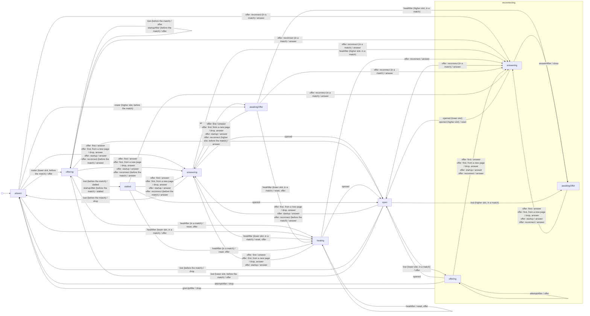

# Peer connection machine

Generated from `web/src/peer-connection.ts` by `node scripts/peer-connection-diagram.mjs`. Do not edit
by hand; `npm run check` fails when it is out of date.

One machine per other player, as one page sees the WebRTC connection to them. It is one side of
`specs/peer_connection.qnt`, built to the variant `peer_connection_fixed`. Nothing uses it yet: the
engine keeps its own flags and timers.

An arrow reads `event (who, when) / commands`: the event or deadline, the page and phase it is taken
in when the state can be met in more than one, and what the machine wants done (it does none of it
itself). The walk is made as the lower slot and as the higher slot of a pair, before and in a match.
The pair walked is the host (slot 0, the lower slot) and one guest. The `reset` on a reconnect goes by
the page, not the pair: every page but the host issues it, so between two guests the lower slot does too.

Not drawn, because every state it moves goes to `absent` on it: `left`.
Not drawn, because every state it moves goes to `absent` on it: `matchEnded`.
Events that leave a state unchanged are not drawn either, unless they make a new offer. Among them:
an answer, a candidate or a channel event for an attempt other than the entry’s, which is ignored
everywhere, and a roster update while the channel is open.

Each state, what it is in the model, and what the engine keeps as flags for it (`peerFacts`):

| State | In the model (`Side`) | Entry | Channel open | Reconnecting |
|---|---|---|---|---|
| `absent` | `has` is false | no | no | no |
| `awaitingOffer` | `has`; nothing offered or answered | yes | no | no |
| `offering` | `made` (then `link`) is its own offer, `attempt` >= 1: the roster offer or a startup retry | yes | no | no |
| `stalled` | the same after the last startup retry: `attempt` = 0, `stalled` | yes | no | no |
| `answering` | `link` is their offer, not `open`, not `recon` | yes | no | no |
| `healing` | `made` (then `link`) is the offer the health check made: `attempt` = 0, not `recon` | yes | no | no |
| `open` | `open` | yes | yes | no |
| `reconnecting.awaitingOffer` | `recon` and `giveUp`; no connection | yes | no | yes |
| `reconnecting.offering` | `recon` and `giveUp`; `made` (then `link`) is its own offer, `attempt` >= 1 | yes | no | yes |
| `reconnecting.answering` | `recon` and `giveUp`; `link` is their offer, `ansTimer` | yes | no | yes |

The deadlines (`PEER_TIMING`, the engine’s numbers today):

| Deadline | In the model | After | Armed in |
|---|---|---|---|
| `startupAfter` | `startupTimeout` | 8 s | `offering` |
| `attemptAfter` | `attemptTimeout` | 10 s | `reconnecting.offering` |
| `giveUpAfter` | `giveUpTimeout` | 45 s | `reconnecting` |
| `answerAfter` | `answerTimeout` | 10 s | `answering`, `reconnecting.answering` |
| `healAfter` | `heal` | 5 s | `absent`, `awaitingOffer`, `offering`, `stalled`, `answering`, `healing` |

`startupAfter` acts only before the match, `healAfter` only in one; `giveUpAfter` runs across the
states of `reconnecting`.
