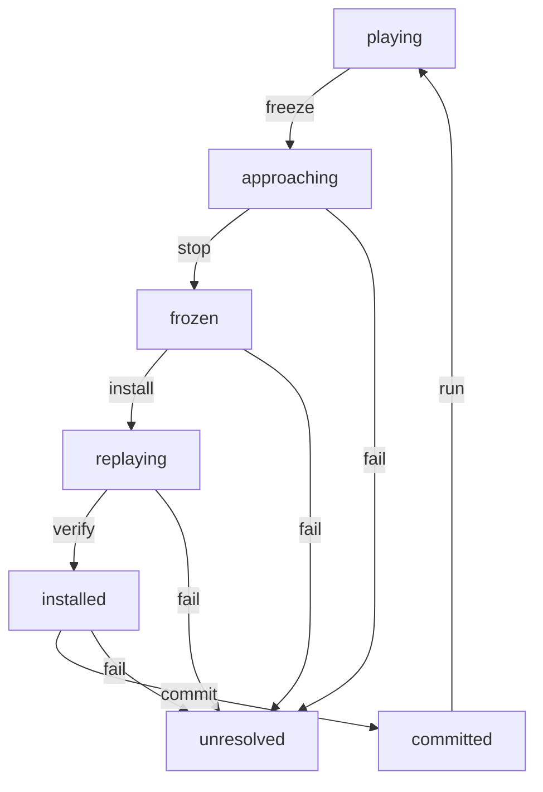

# Per-recipient recovery

Generated by scripts/recovery-diagram.mjs from web/src/recovery-delivery.ts.

```mermaid
flowchart TD
  awaitingAck -->|acknowledged| settled
  awaitingAck -->|deadline| exhausted
  awaitingAck -->|deadline| sending
  awaitingAck -->|peer gone| ended
  awaitingAck -->|stop| ended
  backoff -->|deadline| exhausted
  backoff -->|deadline| sending
  backoff -->|peer gone| ended
  backoff -->|stop| ended
  sending -->|deadline| exhausted
  sending -->|deadline| sending
  sending -->|delivered| awaitingAck
  sending -->|failed| backoff
  sending -->|peer gone| ended
  sending -->|stop| ended
```

Each recipient owns its acknowledgement, delivery/backoff clock, and bounded attempt count.
Ticks use the game's freeze-credited clock; independent wall timers would charge host freezes to guests.
An in-flight recipient with chain progress remains sending. Quiet/no-progress work takes the bounded retry/drop path,
matching the pre-actor lifecycle. Logical exhaustion never frees an uncancellable physical operation early.
The machine emits commands through Effect, and Effect acquire/use/release owns capture and transfer reservations.
A reservation survives actor reset until its physical operation settles; each recipient releases independently.
Cancellation skips queued work before it writes a header. Already-started transfers drain their framing,
keep their permit until settled, and cannot update a cancelled/replaced actor.
Immutable token identity prevents a stale completion from changing a new attempt or releasing its permit.
Resync disabled prevents recovery startup; toggling it off cancels existing actors, not the normal stall path.

Model: specs/recovery_delivery.qnt (actor, delivery, capacity and reservation invariants).

## Verified checkpoint recovery

