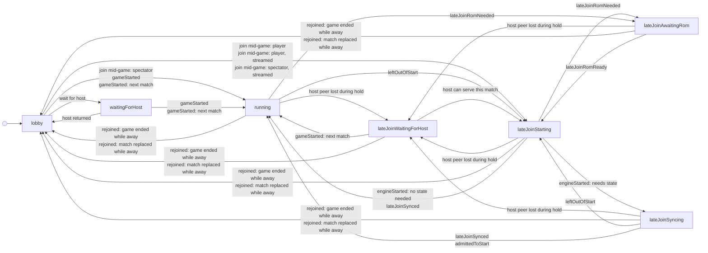
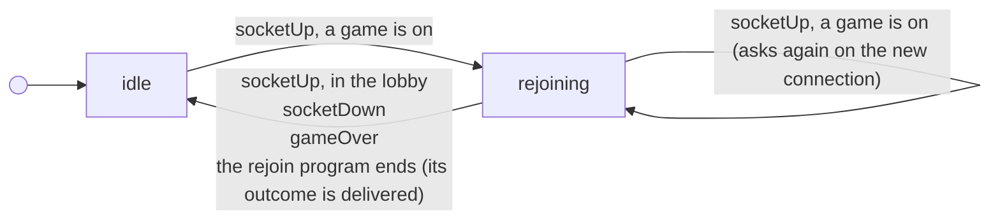
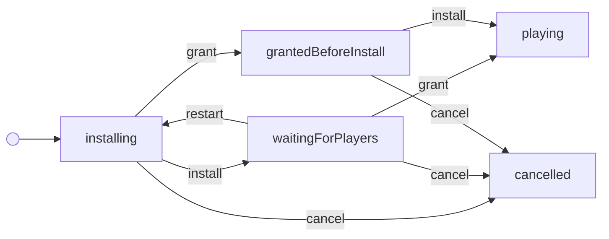
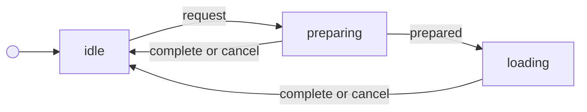

# Page lifecycle machine

Generated from `web/src/session.ts` by `node scripts/session-diagram.mjs`. Do not edit by hand;
`npm run check` fails when it is out of date.

Not drawn, because every state goes to `lobby` on them: `gameEnded`, `roomClosed`, `rejoinRefused`.
Events that leave a state unchanged are not drawn either.

What `play.js` reads from each state (`sessionFlag`):

| State | A game is on | Waiting for a ROM | Next engine start is the late join |
|---|---|---|---|
| `lobby` | no | no | no |
| `waitingForHost` | no | no | no |
| `lateJoinStarting` | yes | no | yes |
| `running` | yes | no | no |
| `lateJoinWaitingForHost` | yes | no | no |
| `lateJoinAwaitingRom` | yes | yes | yes |
| `lateJoinSyncing` | yes | no | no |

The Quint model of the same states, with the server beside them, is `specs/room_lifecycle.qnt`.

# Rejoin machine

Generated from `web/src/rejoin-machine.ts` by the same script. `rejoining` invokes the rejoin
program (`web/src/rejoin-attempt.ts`); leaving the state interrupts it.

# Saved fight return

Each original seat waits for its local engine and the room grant for the same match.
Generated from `web/src/play/match-return.ts`. The Quint model is `room_saved_seat_fixed` in `specs/room_member_return.qnt`.

# Emulator boot

One request owns core preparation and loader construction until completion, timeout or teardown.
Generated from `web/src/play/emulator-boot.ts`. The Quint model is `emulator_boot_fixed` in `specs/emulator_boot.qnt`.

