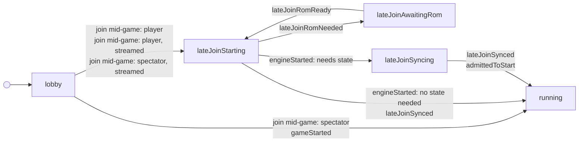

# Page lifecycle machine

Generated from `web/src/session.ts` by `node scripts/session-diagram.mjs`. Do not edit by hand;
`npm run check` fails when it is out of date.

Not drawn, because every state goes to `lobby` on them: `gameEnded`, `roomClosed`, `rejoined: game ended while away`, `rejoined: match replaced while away`.
Events that leave a state unchanged are not drawn either.

What `play.js` reads from each state (`sessionFlag`):

| State | A game is on | Waiting for a ROM | Next engine start is the late join |
|---|---|---|---|
| `lobby` | no | no | no |
| `lateJoinStarting` | yes | no | yes |
| `running` | yes | no | no |
| `lateJoinAwaitingRom` | yes | yes | yes |
| `lateJoinSyncing` | yes | no | no |

The Quint model of the same states, with the server beside them, is `specs/room_lifecycle.qnt`.
