# Spec scenarios as sequence diagrams

Generated by `node scripts/trace-diagram.mjs` from the `run` scenarios of the Quint specs: each one is
replayed by the model checker and drawn from the trace that produced. Do not edit by hand;
`npm run check` fails when it is out of date.

To draw a counterexample instead, see the top of `scripts/trace-diagram.mjs`.

## `specs/game_end.qnt` (`game_end_fixed`)

A host end request waits for the server rather than ending only the host on timeout. The authoritative lobby roster repairs a lost end event, and a delayed request cannot end a rematch.

### timeoutDoesNotEndOnlyHostTest

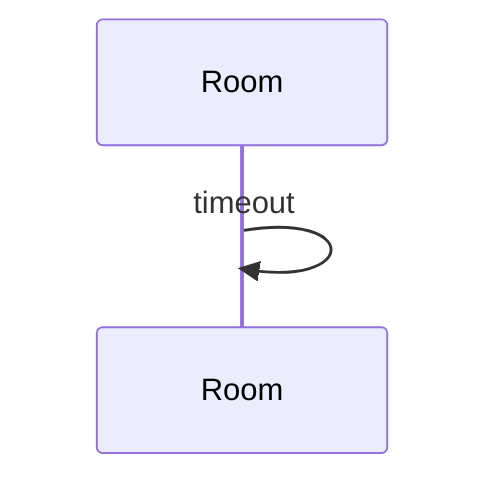

### rosterRepairsLostEndTest

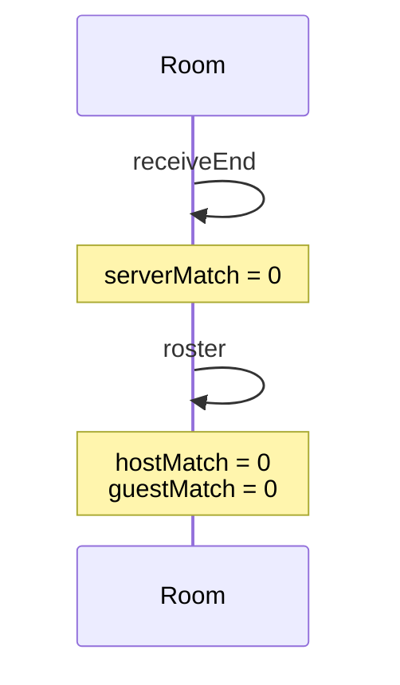

### staleRetryDoesNotEndRematchTest

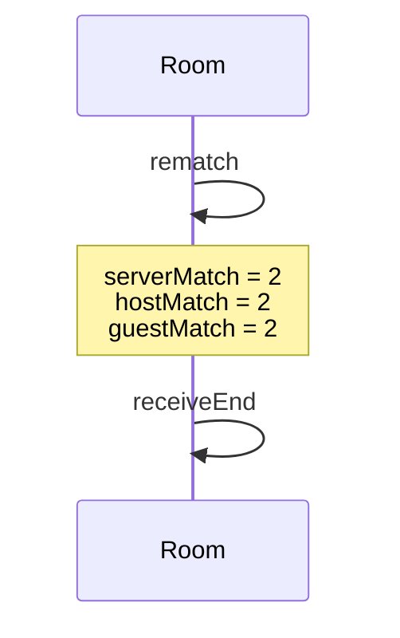

## `specs/room_lifecycle.qnt` (`room_current`)

The server's view of a room against what each player's page is doing. The note on a page is the state it moves to; a dashed arrow is what an action did to another page.

### hostReloadTest

The production sequence: host starts alone, reloads, a friend joins.

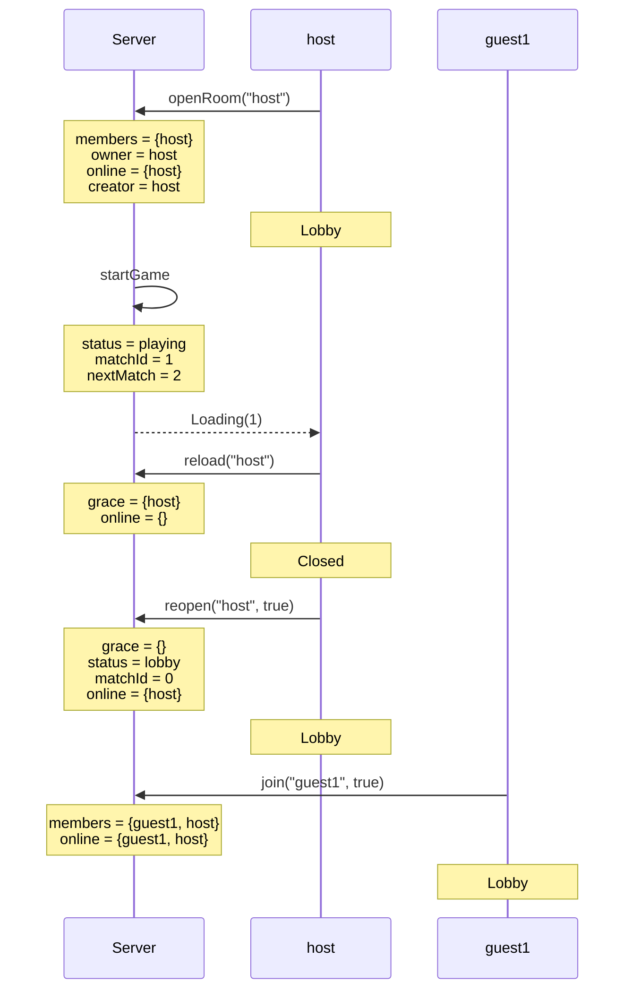

### socketDropKeepsMatchTest

A dropped socket under a running page must not end the match.

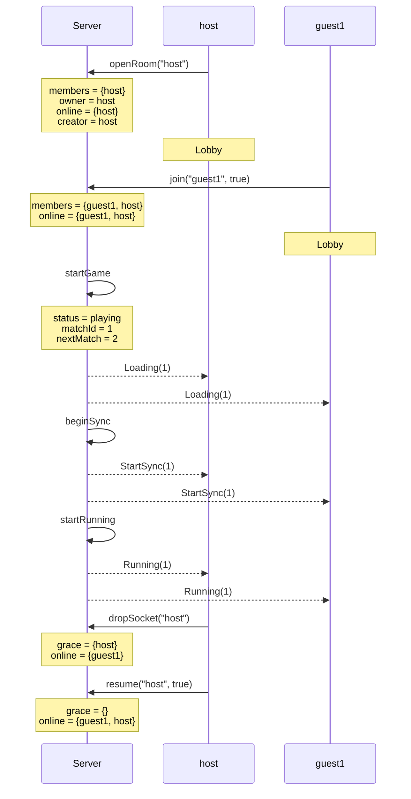

### returnAfterGraceTest

A guest's socket is down for longer than the grace window while the match goes on, then comes back: it is taken back and keeps playing, in every variant. The players' connections never depended on the server.

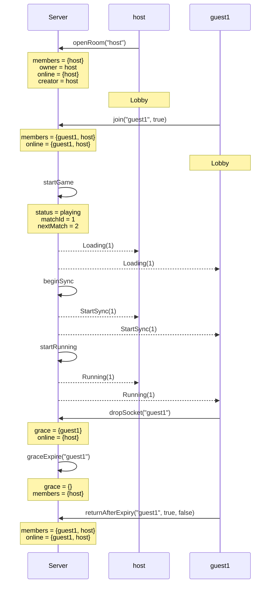

### hostReturnsAfterGraceTest

The host's socket is down for longer than the grace window: the room is handed to the guest and the match goes on. Before, the returning host was told "Room already exists" and never got its signaling back.

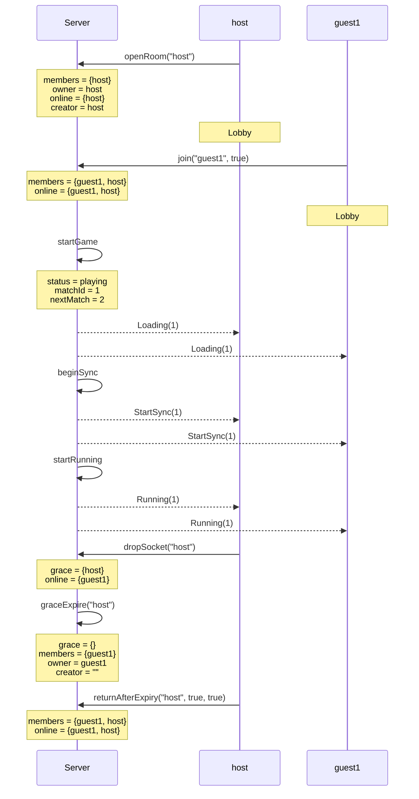

### everyoneDropsTest

Every player's signaling is down for longer than the grace window while the match runs on over their own connections. Before, the room was emptied and the returning host was handed a new, empty room and sent to its lobby. Now their places are kept and both resume the match.

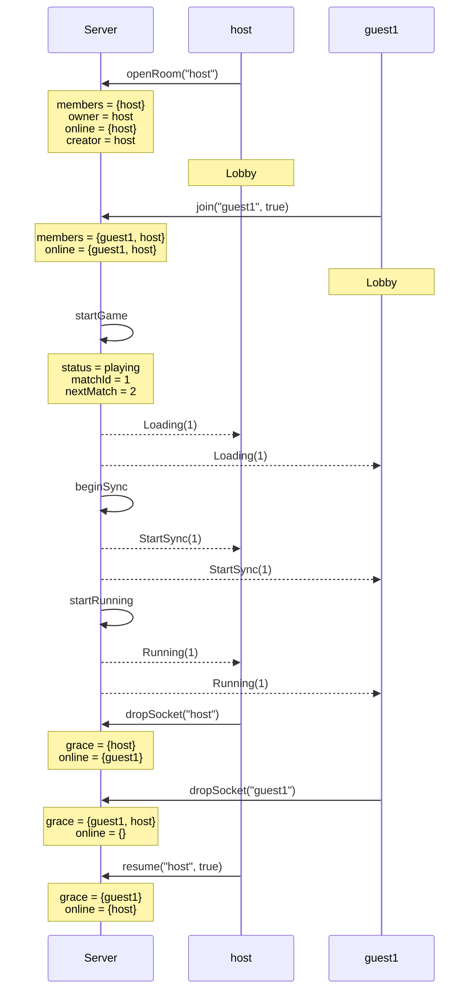

### abandonedMatchTest

The host leaves for good while a joiner is still getting in. Before, the room stayed "playing" with nobody running the match.

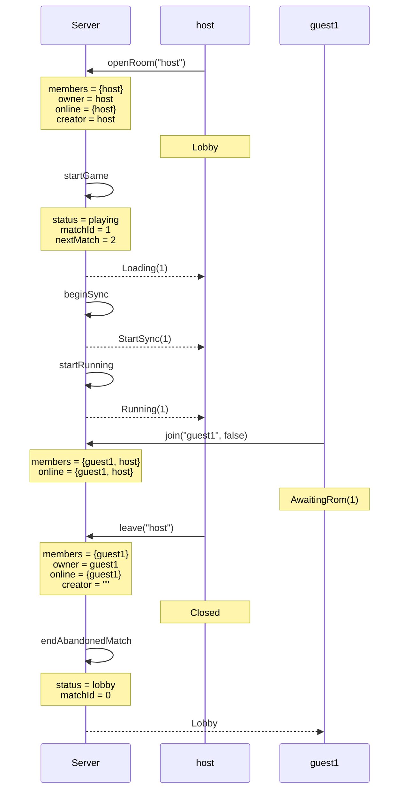

### lateJoinTest

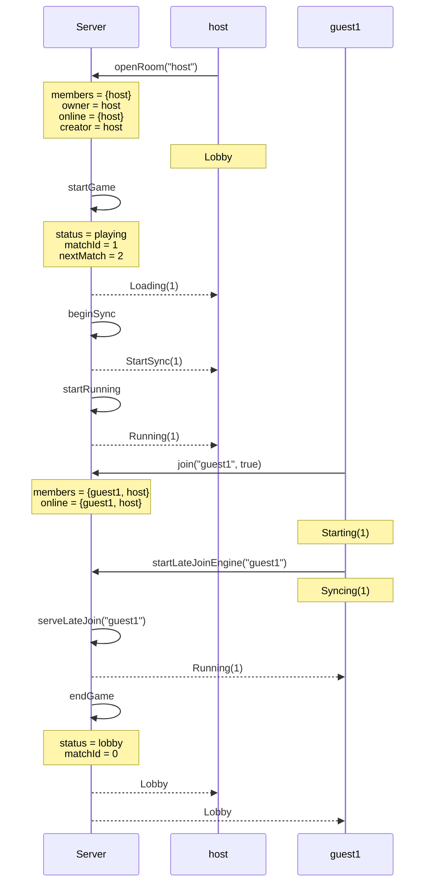

### lateJoinWithoutRomTest

A joiner with no ROM is asked for one before its engine starts.

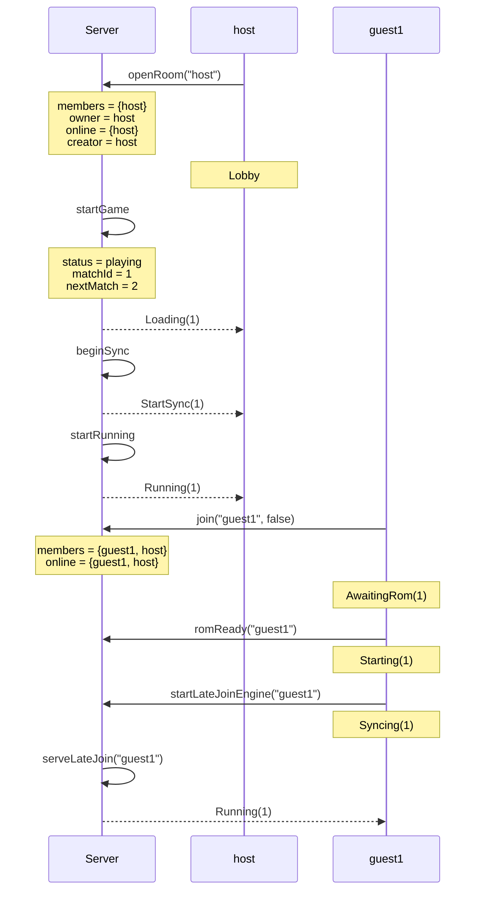

### gameEndsWhileAwaitingRomTest

The host ends the game while a joiner is still choosing a ROM.

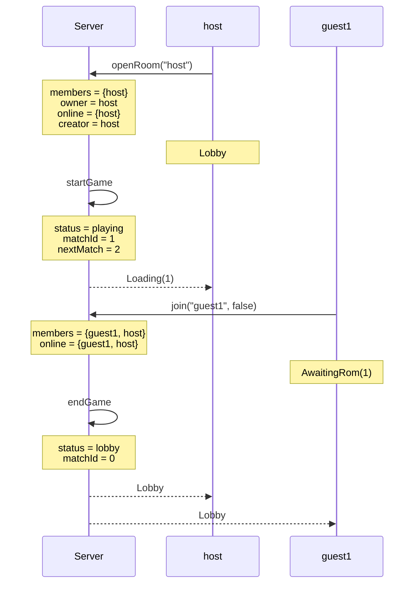

### joinWhileOthersLoadTest

A third player arrives after the host pressed start but before the first two have finished loading. (The same shape as a player whose socket was down when the host pressed start: the page missed game-started and comes back down the late-join path.)

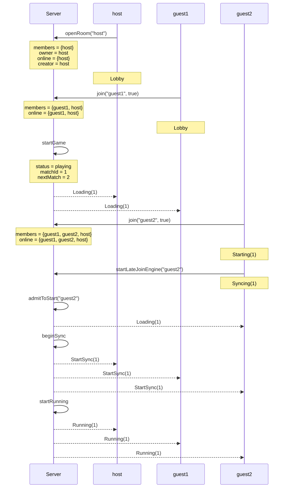

### joinDuringInitialSyncTest

A third player arrives after the first two have begun their initial sync. Nobody is admitted to the start any more: the two run without the newcomer, who is then served as a late joiner.

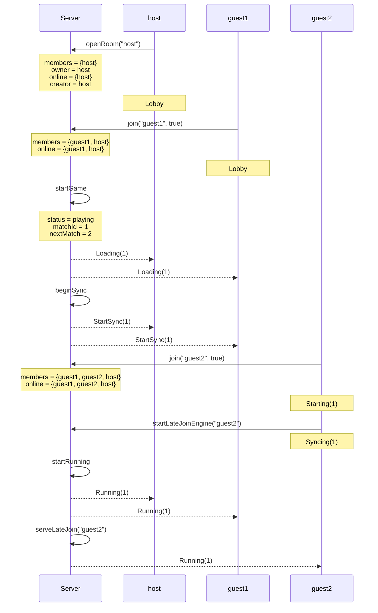

## `specs/streaming_connection.qnt` (`streaming_connection_before_reoffer`)

The streaming engine's connection between the host and a guest, as each page holds it. Network stands for the server relaying the roster and signals and for the connection between the pages; its notes are its own state (`broken`, `closed`), and a dashed arrow is what a step did to a page. The ordering the engine never recovered from before the host had a deadline to offer again: the guest is left with no connection, with both pages still in the room.

### droppedGuestTest

The guest and the host are connected and the stream is up. The network drops the connection for a moment. The guest's connection reports `disconnected`, a state WebRTC means as transient; the guest closes it and forgets the host. That closes it for the host too, whose channel closes, and the host forgets the guest. Both pages are still in the room and the roster has not changed. Before the host's deadline nothing offered again: the guest was left on the last frame of the video for good. Today the deadline offers a new connection and the pair connects.

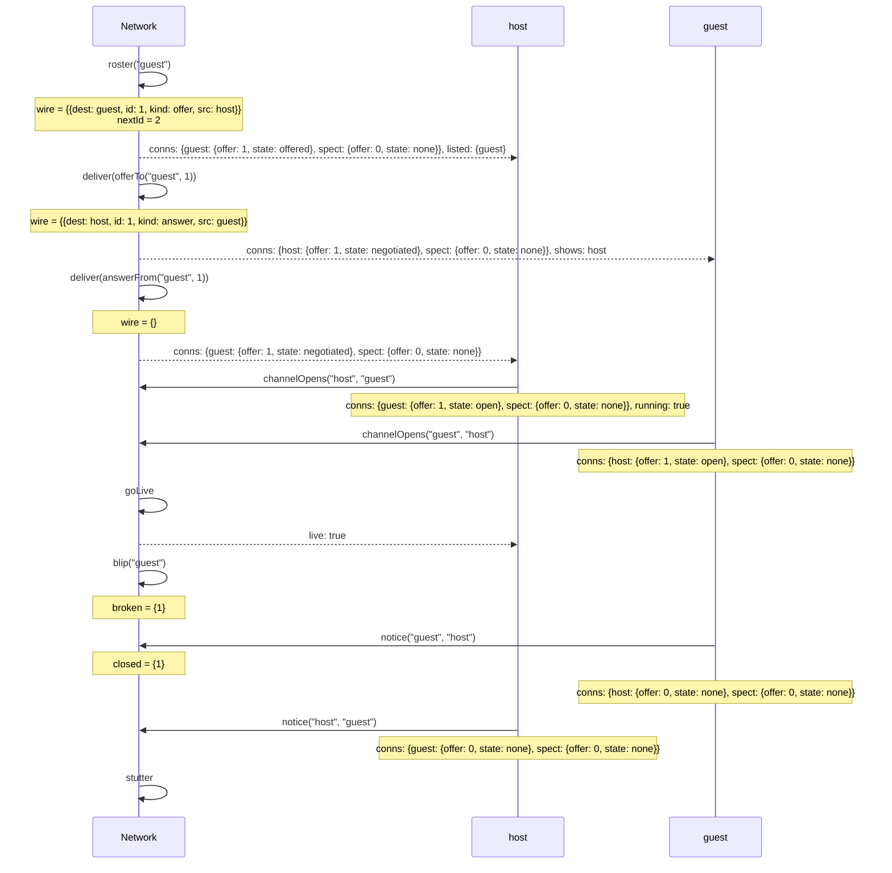

## `specs/streaming_connection.qnt` (`streaming_connection_current`)

The same drop on today's engine. The host's deadline (`reoffer`) offers a new connection and the pair connects again, also when the guest has not yet noticed that its old connection is gone: the new offer names a newer connection than the one the guest holds, so the guest replaces it.

### droppedGuestTest

The guest and the host are connected and the stream is up. The network drops the connection for a moment. The guest's connection reports `disconnected`, a state WebRTC means as transient; the guest closes it and forgets the host. That closes it for the host too, whose channel closes, and the host forgets the guest. Both pages are still in the room and the roster has not changed. Before the host's deadline nothing offered again: the guest was left on the last frame of the video for good. Today the deadline offers a new connection and the pair connects.

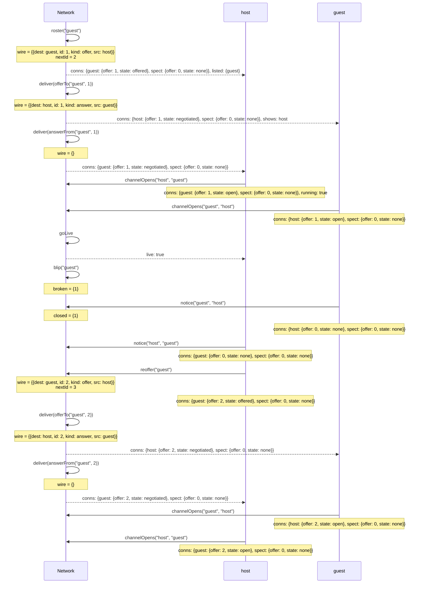

### guestStillHoldsTheOldConnectionTest

The drop again, but the host finds out first: the guest still holds the old connection, whose channel looks open on its page, when the host's deadline offers a new one. The offer names a newer connection than the guest's, so the guest closes its old one and answers from a new one, and the pair connects. Before the deadline nothing offered again.

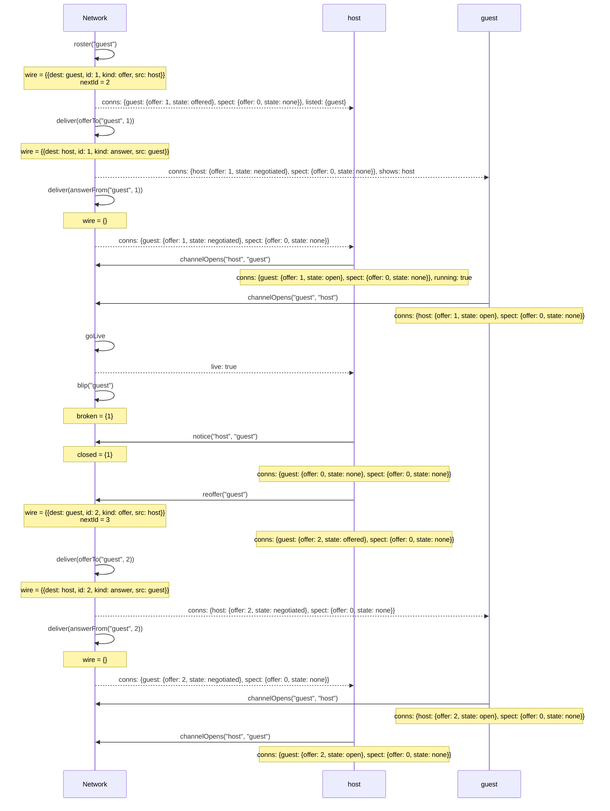

## `specs/rom_identity.qnt` (`rom_identity_before`)

A guest's page judging and announcing its ROM while a dropped file is still being hashed, before the page kept each hash with the load it was computed for. `loaded` is the file the page holds, `hash` and `hashLoad` are `_romHash` and the load it belongs to, `told` is what the server last heard. The host's ROM, dropped over a wrong one, is refused by the wrong one's hash, and its own hash, landing after, says ready with no ROM; a late hash refuses the ROM a newer drop brought.

### rightOverWrongTest

The guest has a wrong ROM, drops the host's over it, and the host's ROM arrives before the new file is hashed. Before, the old hash refused the right ROM, and its hash, landing after, said ready with no ROM. Today the page waits for the new file's hash, which keeps it and says ready.

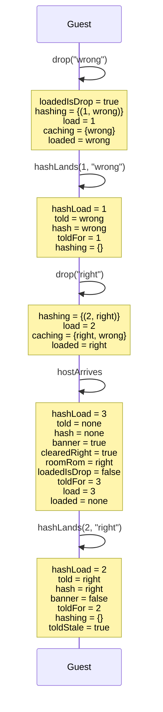

### twoDropsTest

Two drops, the second (the host's ROM) hashed first; the first's hash lands late. Before, that late hash was taken as the loaded ROM's and refused the host's ROM; judging by own hash alone, the page kept the ROM but lost its own hash, so it could never be announced again. Today the late hash changes nothing.

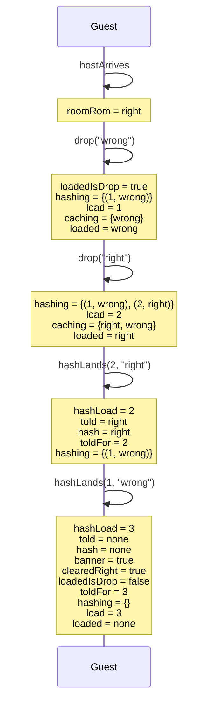

## `specs/rom_identity.qnt` (`rom_identity_current`)

The same orderings today. While a load is being hashed the page waits (`pending`): the host's ROM arriving refuses nothing and nothing is announced, and the drop's own hash, once it lands, decides. A hash for a load the page no longer holds changes nothing.

### rightOverWrongTest

The guest has a wrong ROM, drops the host's over it, and the host's ROM arrives before the new file is hashed. Before, the old hash refused the right ROM, and its hash, landing after, said ready with no ROM. Today the page waits for the new file's hash, which keeps it and says ready.

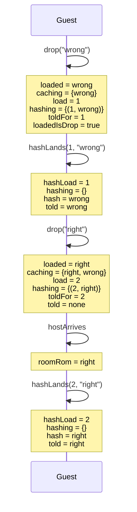

### twoDropsTest

Two drops, the second (the host's ROM) hashed first; the first's hash lands late. Before, that late hash was taken as the loaded ROM's and refused the host's ROM; judging by own hash alone, the page kept the ROM but lost its own hash, so it could never be announced again. Today the late hash changes nothing.

```mermaid
sequenceDiagram
  participant Guest
  Guest->>Guest: hostArrives
  Note over Guest: roomRom = right
  Guest->>Guest: drop("wrong")
  Note over Guest: loaded = wrong<br/>caching = {wrong}<br/>load = 1<br/>hashing = {(1, wrong)}<br/>toldFor = 1<br/>loadedIsDrop = true
  Guest->>Guest: drop("right")
  Note over Guest: loaded = right<br/>caching = {right, wrong}<br/>load = 2<br/>hashing = {(1, wrong), (2, right)}<br/>toldFor = 2
  Guest->>Guest: hashLands(2, "right")
  Note over Guest: hashLoad = 2<br/>hashing = {(1, wrong)}<br/>hash = right<br/>told = right
  Guest->>Guest: hashLands(1, "wrong")
  Note over Guest: hashing = {}
```

## `specs/rom_identity.qnt` (`rom_identity_host_silent`)

The host changing its ROM while the host's drop said nothing (#289). `roomRom` is the host's ROM as the room names it and the guest has heard; the names follow the host, so `"right"` is always the ROM the host holds. Until the host's new ROM is hashed the room names its previous one (`"wrong"`): the guest's ROM that is the host's new one is refused against it, and a guest holding the previous one is still counted ready on it.

### hostChangesToTheGuestsRomTest

The host's ROM is known, and the host drops another: the one the guest is about to drop (the guest's "wrong" is "right" from here on). The guest drops it, and its hash lands before the host's. With the host's drop unsaid, the room still names the host's previous ROM, and the guest's ROM, the host's new one, is refused against it. Today the room's ROM is changing: the guest's page waits, and the host's hash, landing, finds the guest's ROM is the host's and it is announced.

```mermaid
sequenceDiagram
  participant Guest
  Guest->>Guest: hostArrives
  Note over Guest: roomRom = right
  Guest->>Guest: hostDrops(true)
  Note over Guest: hostHashing = true<br/>roomRom = wrong
  Guest->>Guest: drop("right")
  Note over Guest: loaded = right<br/>caching = {right}<br/>load = 1<br/>hashing = {(1, right)}<br/>toldFor = 1<br/>loadedIsDrop = true
  Guest->>Guest: hashLands(1, "right")
  Note over Guest: hashLoad = 2<br/>loaded = none<br/>load = 2<br/>hashing = {}<br/>toldFor = 2<br/>loadedIsDrop = false<br/>clearedRight = true<br/>banner = true
  Guest->>Guest: hostHashLands
  Note over Guest: hostHashing = false<br/>roomRom = right
```

### hostChangesAwayFromTheGuestsRomTest

The guest holds the host's ROM, and the server has heard so; the host drops another, one the guest has never held. With the host's drop unsaid, the room names the host's previous ROM while the new one is hashed: the server still counts the guest ready on it, and the page says so again at the next room change. Today the server drops the guest's word at once and the page waits. Either way the host's hash, landing, drops the guest's word and refuses its ROM.

```mermaid
sequenceDiagram
  participant Guest
  Guest->>Guest: hostArrives
  Note over Guest: roomRom = right
  Guest->>Guest: drop("right")
  Note over Guest: loaded = right<br/>caching = {right}<br/>load = 1<br/>hashing = {(1, right)}<br/>toldFor = 1<br/>loadedIsDrop = true
  Guest->>Guest: hashLands(1, "right")
  Note over Guest: hashLoad = 1<br/>hashing = {}<br/>hash = right<br/>told = right
  Guest->>Guest: hostDrops(false)
  Note over Guest: hostHashing = true<br/>loaded = wrong<br/>caching = {wrong}<br/>roomRom = wrong<br/>hash = wrong<br/>told = wrong
  Guest->>Guest: roomUpdate
  Guest->>Guest: hostHashLands
  Note over Guest: hostHashing = false<br/>hashLoad = 2<br/>loaded = none<br/>load = 2<br/>toldFor = 2<br/>loadedIsDrop = false<br/>roomRom = right<br/>banner = true<br/>hash = none<br/>told = none
```

## `specs/rom_identity.qnt` (`rom_identity_current`)

The same orderings today. The host's drop says its ROM is being hashed: the room names none (`changing`) and drops every guest's word, the guest's page judges nothing and says nothing, and the host's hash, once it is the room's, decides.

### hostChangesToTheGuestsRomTest

The host's ROM is known, and the host drops another: the one the guest is about to drop (the guest's "wrong" is "right" from here on). The guest drops it, and its hash lands before the host's. With the host's drop unsaid, the room still names the host's previous ROM, and the guest's ROM, the host's new one, is refused against it. Today the room's ROM is changing: the guest's page waits, and the host's hash, landing, finds the guest's ROM is the host's and it is announced.

```mermaid
sequenceDiagram
  participant Guest
  Guest->>Guest: hostArrives
  Note over Guest: roomRom = right
  Guest->>Guest: hostDrops(true)
  Note over Guest: hostHashing = true<br/>roomRom = changing
  Guest->>Guest: drop("right")
  Note over Guest: loaded = right<br/>caching = {right}<br/>load = 1<br/>hashing = {(1, right)}<br/>toldFor = 1<br/>loadedIsDrop = true
  Guest->>Guest: hashLands(1, "right")
  Note over Guest: hashLoad = 1<br/>hashing = {}<br/>hash = right
  Guest->>Guest: hostHashLands
  Note over Guest: hostHashing = false<br/>roomRom = right<br/>told = right
```

### hostChangesAwayFromTheGuestsRomTest

The guest holds the host's ROM, and the server has heard so; the host drops another, one the guest has never held. With the host's drop unsaid, the room names the host's previous ROM while the new one is hashed: the server still counts the guest ready on it, and the page says so again at the next room change. Today the server drops the guest's word at once and the page waits. Either way the host's hash, landing, drops the guest's word and refuses its ROM.

```mermaid
sequenceDiagram
  participant Guest
  Guest->>Guest: hostArrives
  Note over Guest: roomRom = right
  Guest->>Guest: drop("right")
  Note over Guest: loaded = right<br/>caching = {right}<br/>load = 1<br/>hashing = {(1, right)}<br/>toldFor = 1<br/>loadedIsDrop = true
  Guest->>Guest: hashLands(1, "right")
  Note over Guest: hashLoad = 1<br/>hashing = {}<br/>hash = right<br/>told = right
  Guest->>Guest: hostDrops(false)
  Note over Guest: hostHashing = true<br/>loaded = wrong<br/>caching = {wrong}<br/>roomRom = changing<br/>hash = wrong<br/>told = none
  Guest->>Guest: roomUpdate
  Guest->>Guest: hostHashLands
  Note over Guest: hostHashing = false<br/>hashLoad = 2<br/>loaded = none<br/>load = 2<br/>toldFor = 2<br/>loadedIsDrop = false<br/>roomRom = right<br/>banner = true<br/>hash = none
```

## `specs/rom_identity.qnt` (`rom_identity_no_library`)

The guest drops the ROM the host is about to change to, a moment before the host does (#303). Its copy lands in the library (`cacheLands`), and it is refused, rightly, against the host's ROM of the moment. When the room names the host's new ROM the page holds none, and stays so: it looked in its library only after a refusal (`missedLibraryRom`).

### guestDroppedFirstTest

The players agree to switch games and the guest drops the new ROM a moment before the host does: its copy lands in the library, and it is refused, correctly, against the ROM the host still holds. The host then drops the same ROM (the guest's "wrong" is "right" from here on), and its hash lands. Until now the guest stayed without a ROM and had to drop it again; today the page loads it from the library and says ready.

```mermaid
sequenceDiagram
  participant Guest
  Guest->>Guest: hostArrives
  Note over Guest: roomRom = right
  Guest->>Guest: drop("wrong")
  Note over Guest: loadedIsDrop = true<br/>toldFor = 1<br/>hashing = {(1, wrong)}<br/>load = 1<br/>caching = {wrong}<br/>loaded = wrong
  Guest->>Guest: cacheLands("wrong")
  Note over Guest: caching = {}<br/>library = {wrong}
  Guest->>Guest: hashLands(1, "wrong")
  Note over Guest: hashLoad = 2<br/>banner = true<br/>loadedIsDrop = false<br/>toldFor = 2<br/>hashing = {}<br/>load = 2<br/>loaded = none
  Guest->>Guest: hostDrops(true)
  Note over Guest: hostHashing = true<br/>roomRom = changing<br/>library = {right}
  Guest->>Guest: hostHashLands
  Note over Guest: hostHashing = false<br/>roomRom = right<br/>missedLibraryRom = true
```

## `specs/rom_identity.qnt` (`rom_identity_current`)

The same ordering today. When the room names the host's new ROM and the page holds none, it looks in its library, finds the ROM it dropped, loads it and says ready.

### guestDroppedFirstTest

The players agree to switch games and the guest drops the new ROM a moment before the host does: its copy lands in the library, and it is refused, correctly, against the ROM the host still holds. The host then drops the same ROM (the guest's "wrong" is "right" from here on), and its hash lands. Until now the guest stayed without a ROM and had to drop it again; today the page loads it from the library and says ready.

```mermaid
sequenceDiagram
  participant Guest
  Guest->>Guest: hostArrives
  Note over Guest: roomRom = right
  Guest->>Guest: drop("wrong")
  Note over Guest: loaded = wrong<br/>caching = {wrong}<br/>load = 1<br/>hashing = {(1, wrong)}<br/>toldFor = 1<br/>loadedIsDrop = true
  Guest->>Guest: cacheLands("wrong")
  Note over Guest: library = {wrong}<br/>caching = {}
  Guest->>Guest: hashLands(1, "wrong")
  Note over Guest: hashLoad = 2<br/>loaded = none<br/>load = 2<br/>hashing = {}<br/>toldFor = 2<br/>loadedIsDrop = false<br/>banner = true
  Guest->>Guest: hostDrops(true)
  Note over Guest: hostHashing = true<br/>library = {right}<br/>roomRom = changing
  Guest->>Guest: hostHashLands
  Note over Guest: hostHashing = false<br/>hashLoad = 3<br/>loaded = right<br/>load = 3<br/>toldFor = 3<br/>roomRom = right<br/>banner = false<br/>hash = right<br/>told = right
```
