# Spec scenarios as sequence diagrams

Generated by `node scripts/trace-diagram.mjs` from the `run` scenarios of the Quint specs: each one is
replayed by the model checker and drawn from the trace that produced. Do not edit by hand;
`npm run check` fails when it is out of date.

To draw a counterexample instead, see the top of `scripts/trace-diagram.mjs`.

## `specs/room_lifecycle.qnt` (`room_current`)

The server's view of a room against what each player's page is doing. The note on a page is the state it moves to; a dashed arrow is what an action did to another page.

### hostReloadTest

The production sequence: host starts alone, reloads, a friend joins.

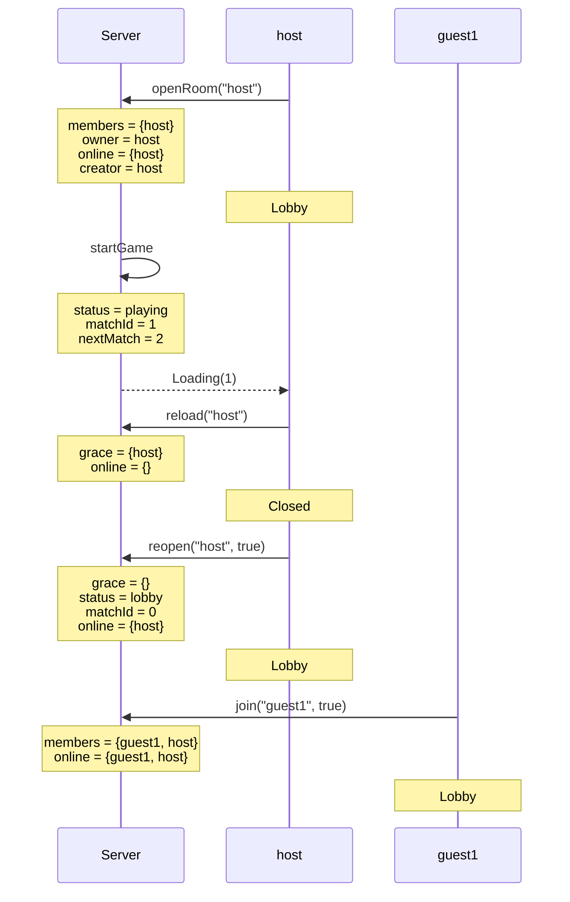

### socketDropKeepsMatchTest

A dropped socket under a running page must not end the match.

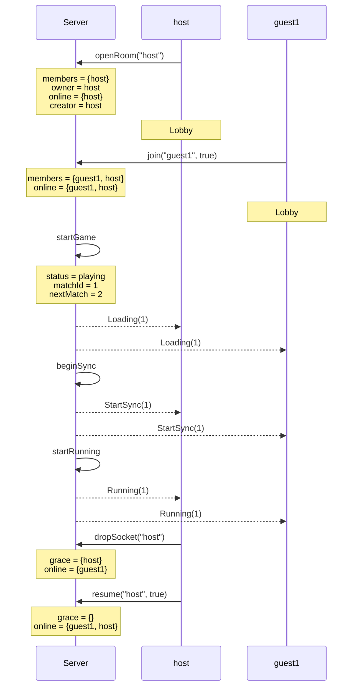

### returnAfterGraceTest

A guest's socket is down for longer than the grace window while the match goes on, then comes back: it is taken back and keeps playing, in every variant. The players' connections never depended on the server.

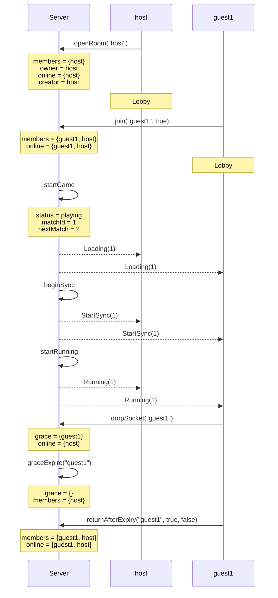

### hostReturnsAfterGraceTest

The host's socket is down for longer than the grace window: the room is handed to the guest and the match goes on. Before, the returning host was told "Room already exists" and never got its signaling back.

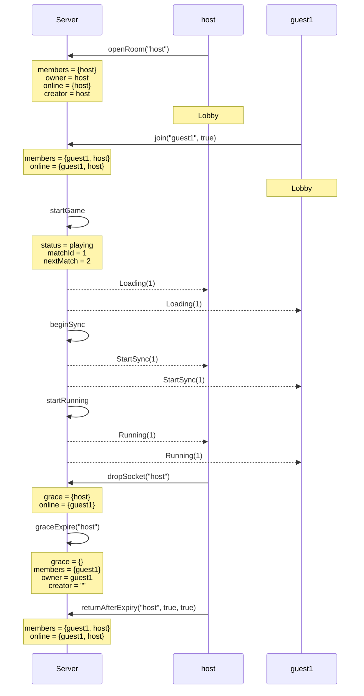

### everyoneDropsTest

Every player's signaling is down for longer than the grace window while the match runs on over their own connections. Before, the room was emptied and the returning host was handed a new, empty room and sent to its lobby. Now their places are kept and both resume the match.

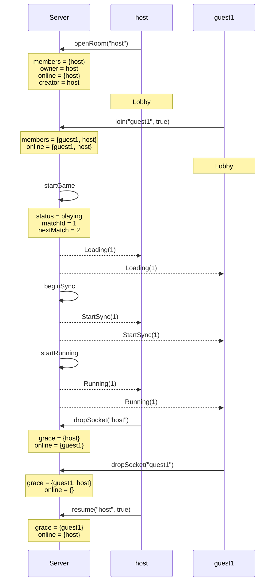

### abandonedMatchTest

The host leaves for good while a joiner is still getting in. Before, the room stayed "playing" with nobody running the match.

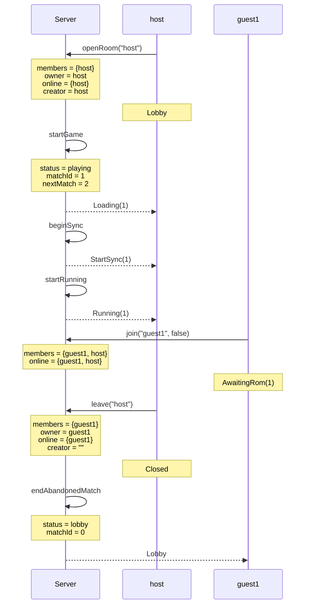

### lateJoinTest

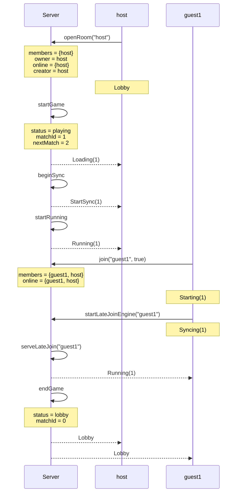

### lateJoinWithoutRomTest

A joiner with no ROM is asked for one before its engine starts.

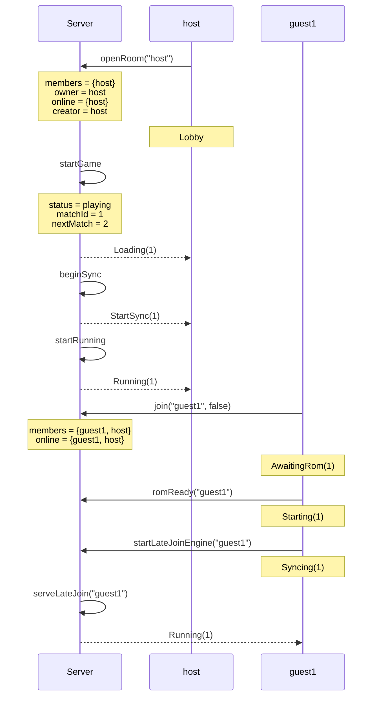

### gameEndsWhileAwaitingRomTest

The host ends the game while a joiner is still choosing a ROM.

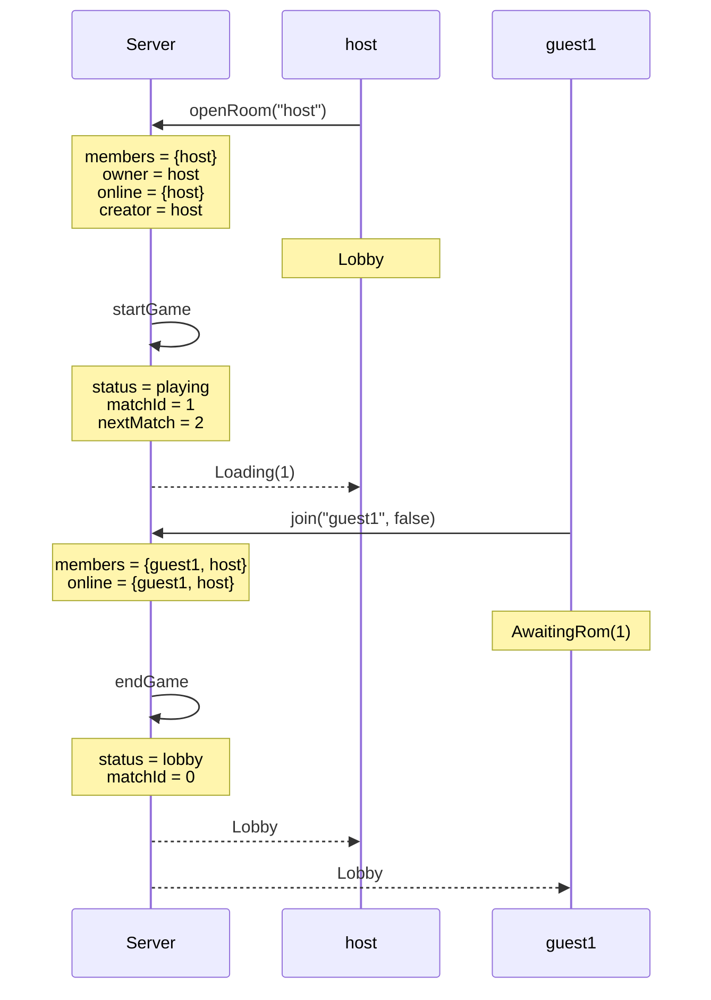

### joinWhileOthersLoadTest

A third player arrives after the host pressed start but before the first two have finished loading. (The same shape as a player whose socket was down when the host pressed start: the page missed game-started and comes back down the late-join path.)

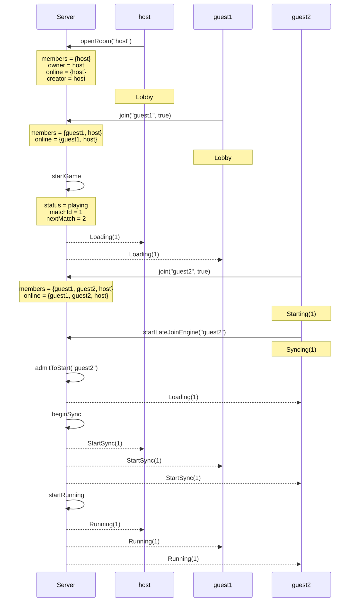

### joinDuringInitialSyncTest

A third player arrives after the first two have begun their initial sync. Nobody is admitted to the start any more: the two run without the newcomer, who is then served as a late joiner.

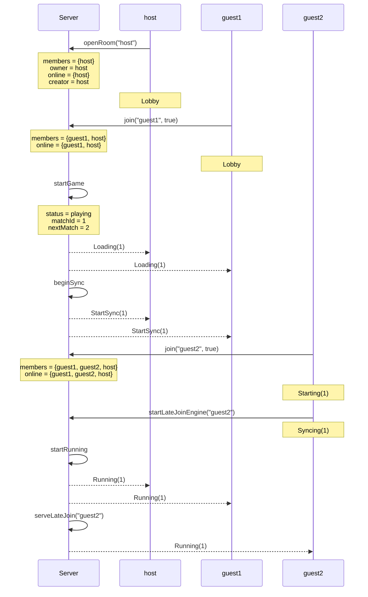
