# Spec scenarios as sequence diagrams

Generated by `node scripts/trace-diagram.mjs` from the `run` scenarios of the Quint specs: each one is
replayed by the model checker and drawn from the trace that produced. Do not edit by hand;
`npm run check` fails when it is out of date.

To draw a counterexample instead, see the top of `scripts/trace-diagram.mjs`.

## `specs/room_lifecycle.qnt` (`room_current`)

The server's view of a room against what each player's page is doing. The note on a page is the state it moves to; a dashed arrow is what an action did to another page.

### hostReloadTest

The production sequence: host starts alone, reloads, a friend joins.

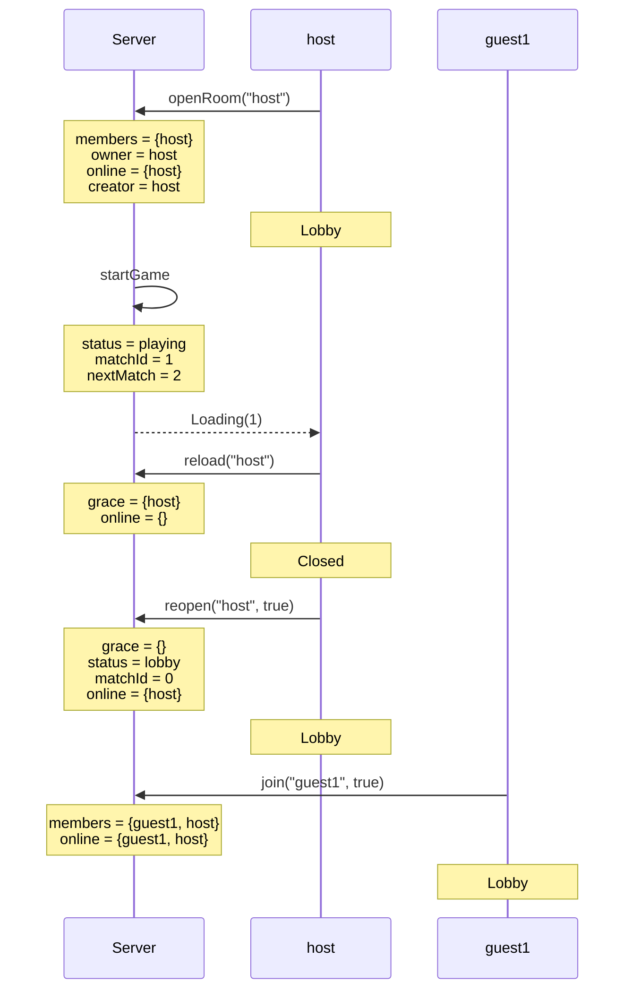

### socketDropKeepsMatchTest

A dropped socket under a running page must not end the match.

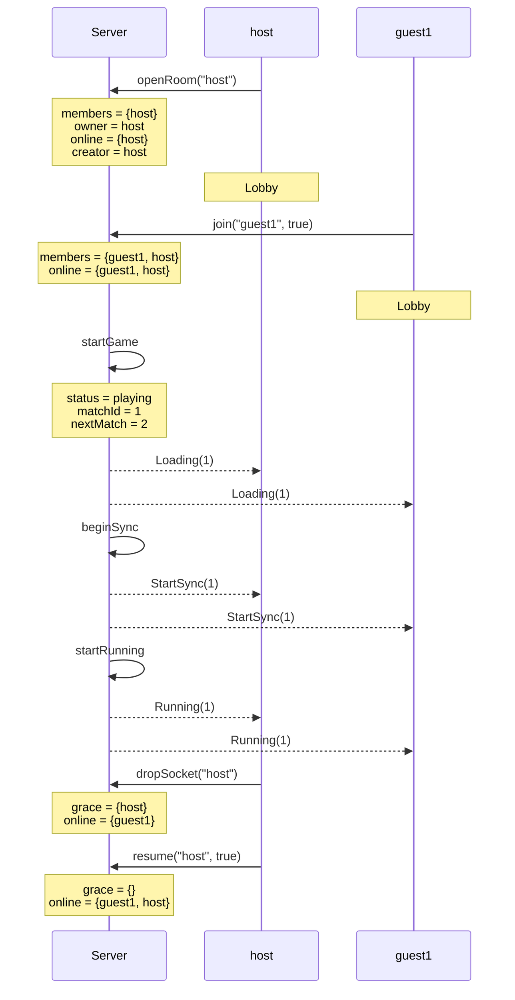

### returnAfterGraceTest

A guest's socket is down for longer than the grace window while the match goes on, then comes back: it is taken back and keeps playing, in every variant. The players' connections never depended on the server.

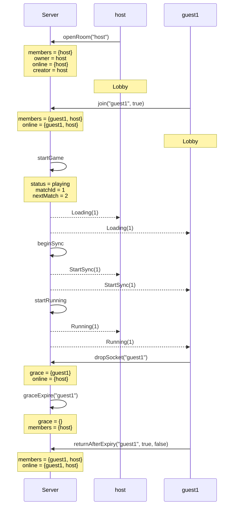

### hostReturnsAfterGraceTest

The host's socket is down for longer than the grace window: the room is handed to the guest and the match goes on. Before, the returning host was told "Room already exists" and never got its signaling back.

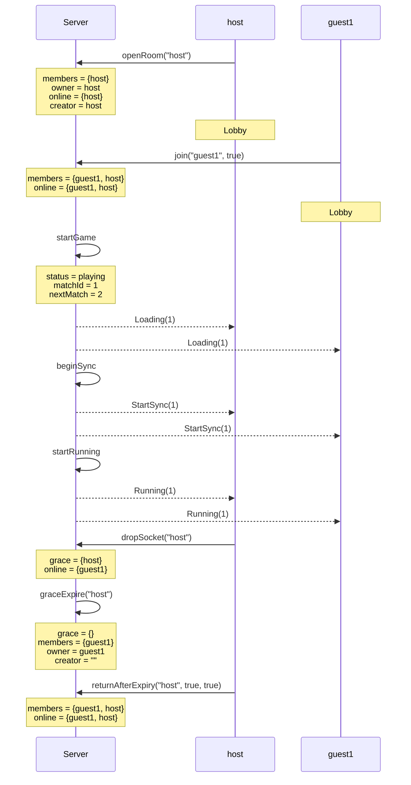

### everyoneDropsTest

Every player's signaling is down for longer than the grace window while the match runs on over their own connections. Before, the room was emptied and the returning host was handed a new, empty room and sent to its lobby. Now their places are kept and both resume the match.

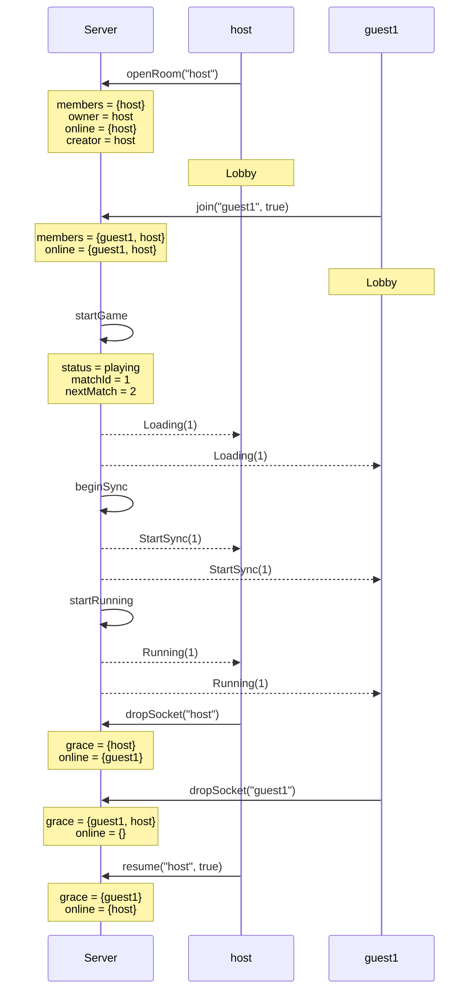

### abandonedMatchTest

The host leaves for good while a joiner is still getting in. Before, the room stayed "playing" with nobody running the match.

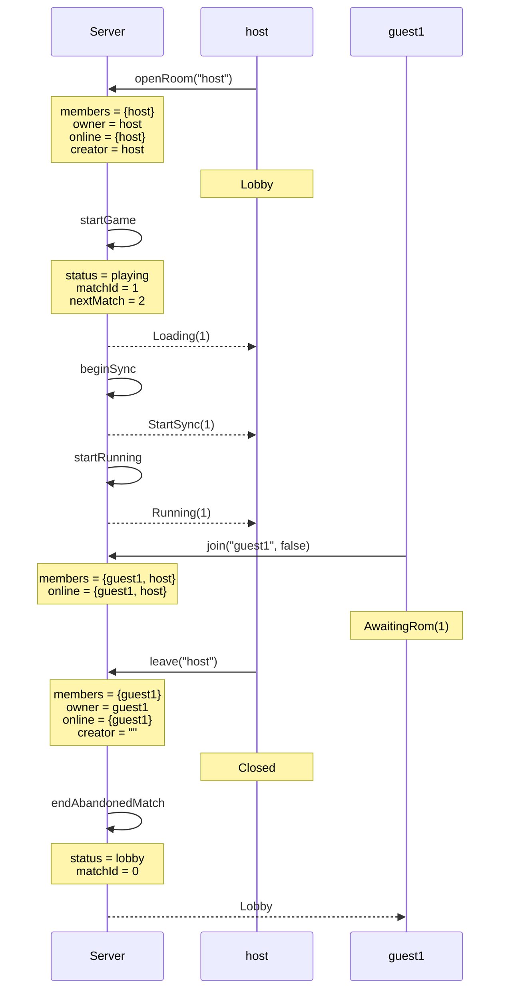

### lateJoinTest

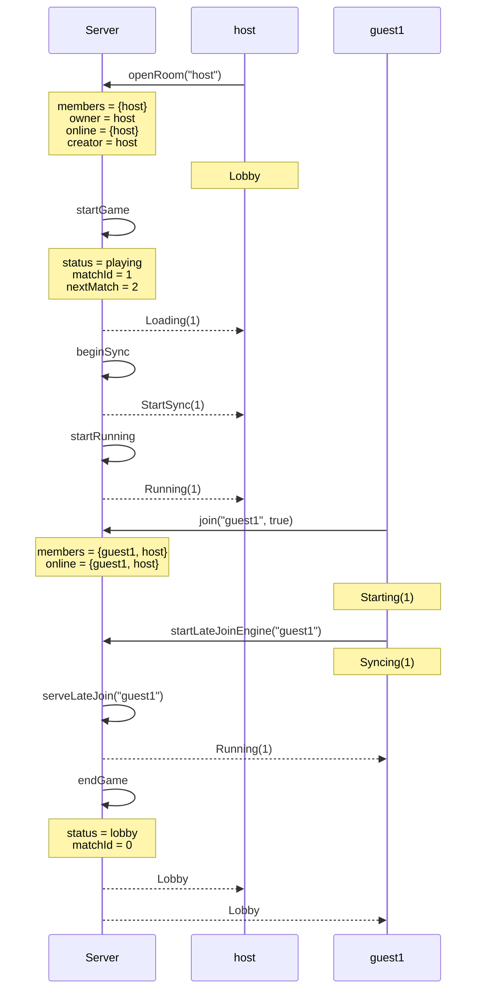

### lateJoinWithoutRomTest

A joiner with no ROM is asked for one before its engine starts.

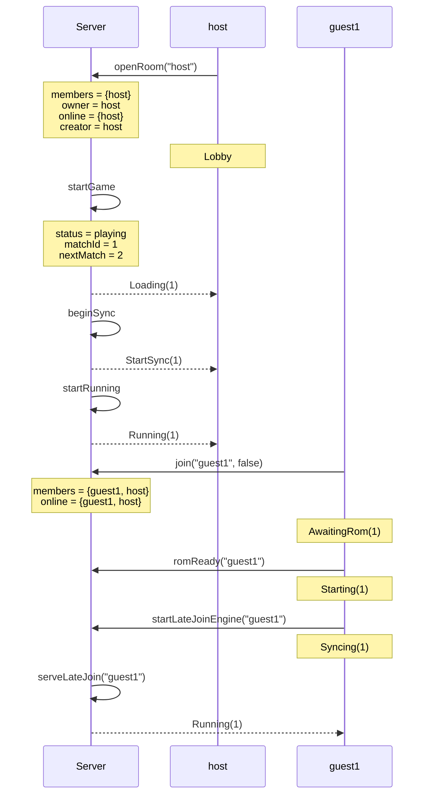

### gameEndsWhileAwaitingRomTest

The host ends the game while a joiner is still choosing a ROM.

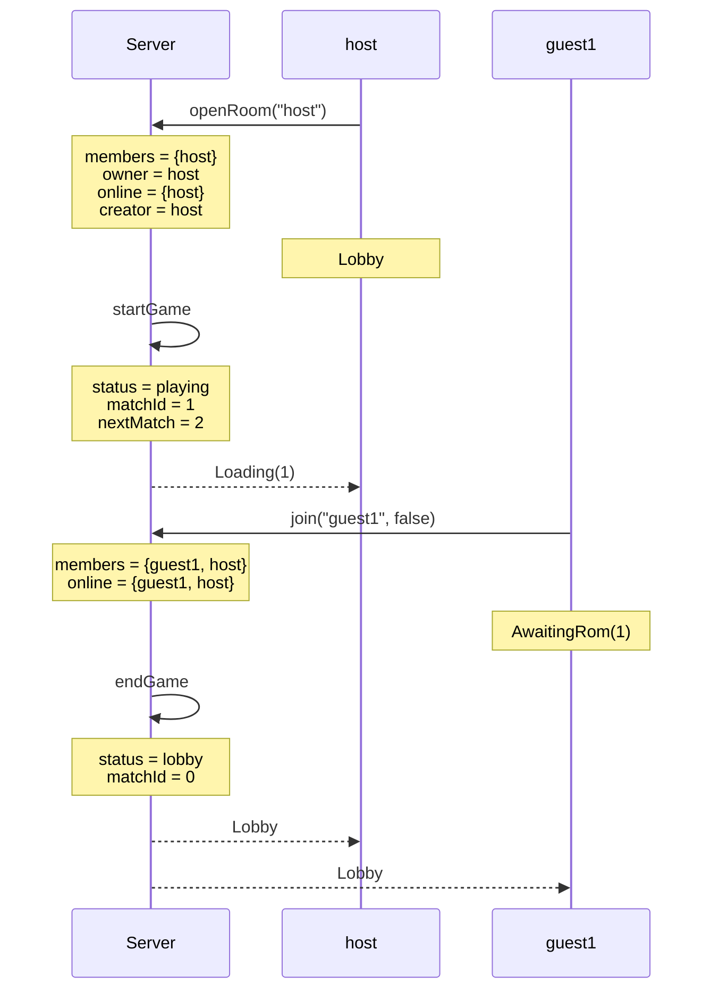

### joinWhileOthersLoadTest

A third player arrives after the host pressed start but before the first two have finished loading. (The same shape as a player whose socket was down when the host pressed start: the page missed game-started and comes back down the late-join path.)

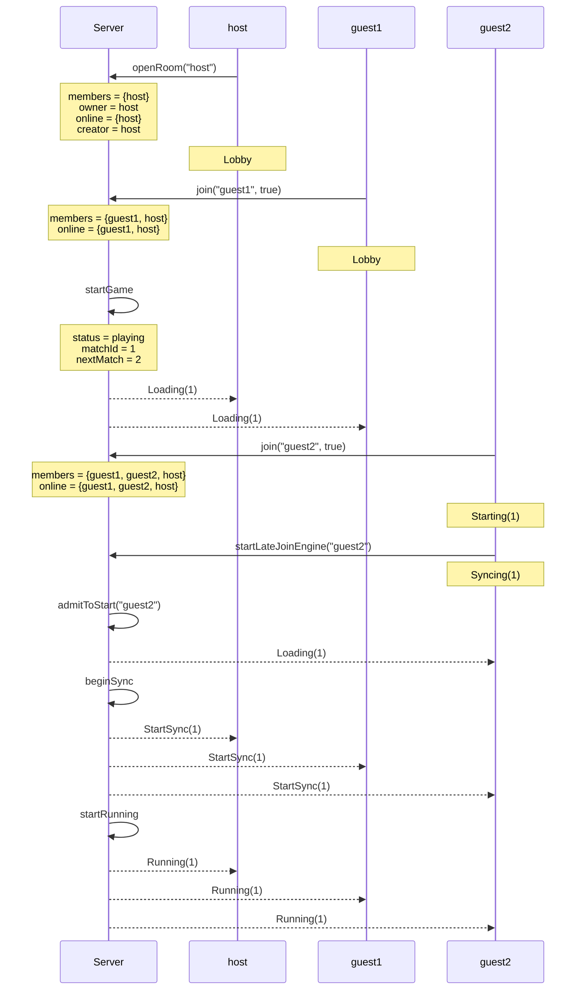

### joinDuringInitialSyncTest

A third player arrives after the first two have begun their initial sync. Nobody is admitted to the start any more: the two run without the newcomer, who is then served as a late joiner.

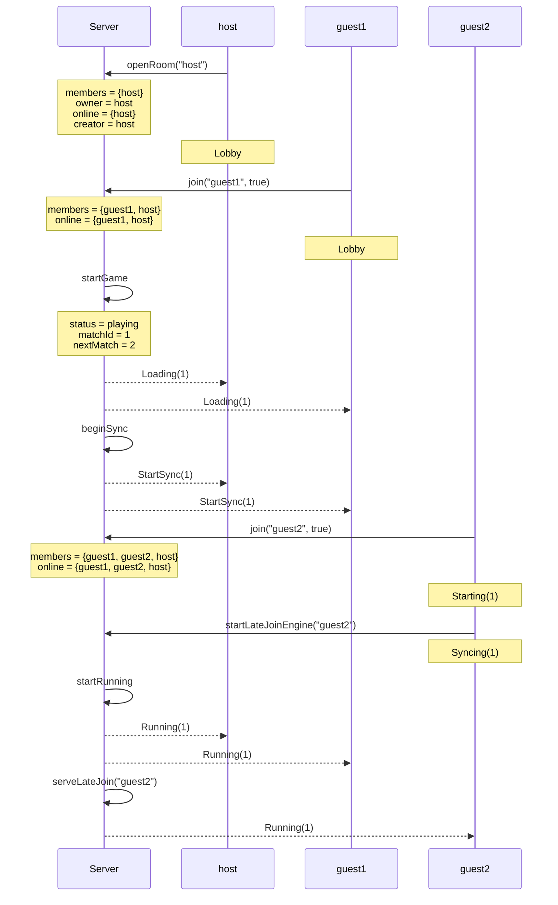

## `specs/streaming_connection.qnt` (`streaming_connection_before_reoffer`)

The streaming engine's connection between the host and a guest, as each page holds it. Network stands for the server relaying the roster and signals and for the connection between the pages; its notes are its own state (`broken`, `closed`), and a dashed arrow is what a step did to a page. The ordering the engine never recovered from before the host had a deadline to offer again: the guest is left with no connection, with both pages still in the room.

### droppedGuestTest

The guest and the host are connected and the stream is up. The network drops the connection for a moment. The guest's connection reports `disconnected`, a state WebRTC means as transient; the guest closes it and forgets the host. That closes it for the host too, whose channel closes, and the host forgets the guest. Both pages are still in the room and the roster has not changed. Before the host's deadline nothing offered again: the guest was left on the last frame of the video for good. Today the deadline offers a new connection and the pair connects.

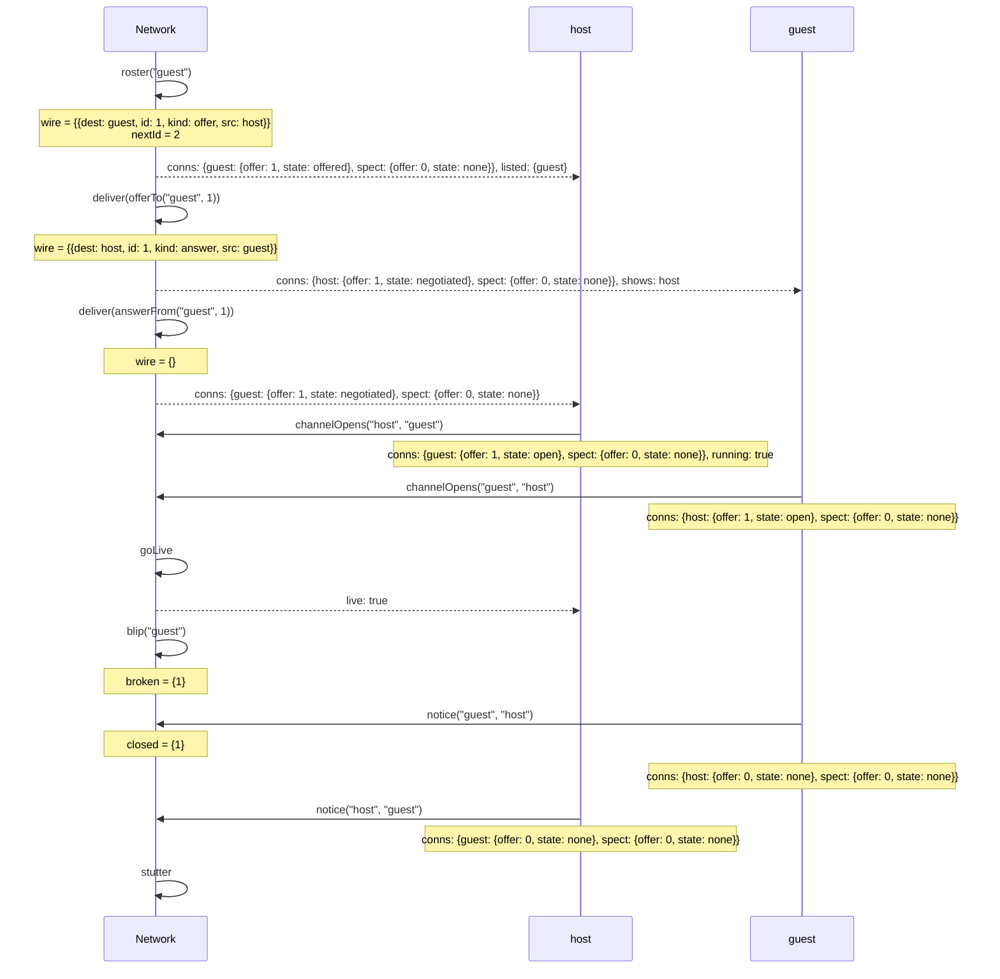

## `specs/streaming_connection.qnt` (`streaming_connection_current`)

The same drop on today's engine. The host's deadline (`reoffer`) offers a new connection and the pair connects again, also when the guest has not yet noticed that its old connection is gone: the new offer names a newer connection than the one the guest holds, so the guest replaces it.

### droppedGuestTest

The guest and the host are connected and the stream is up. The network drops the connection for a moment. The guest's connection reports `disconnected`, a state WebRTC means as transient; the guest closes it and forgets the host. That closes it for the host too, whose channel closes, and the host forgets the guest. Both pages are still in the room and the roster has not changed. Before the host's deadline nothing offered again: the guest was left on the last frame of the video for good. Today the deadline offers a new connection and the pair connects.

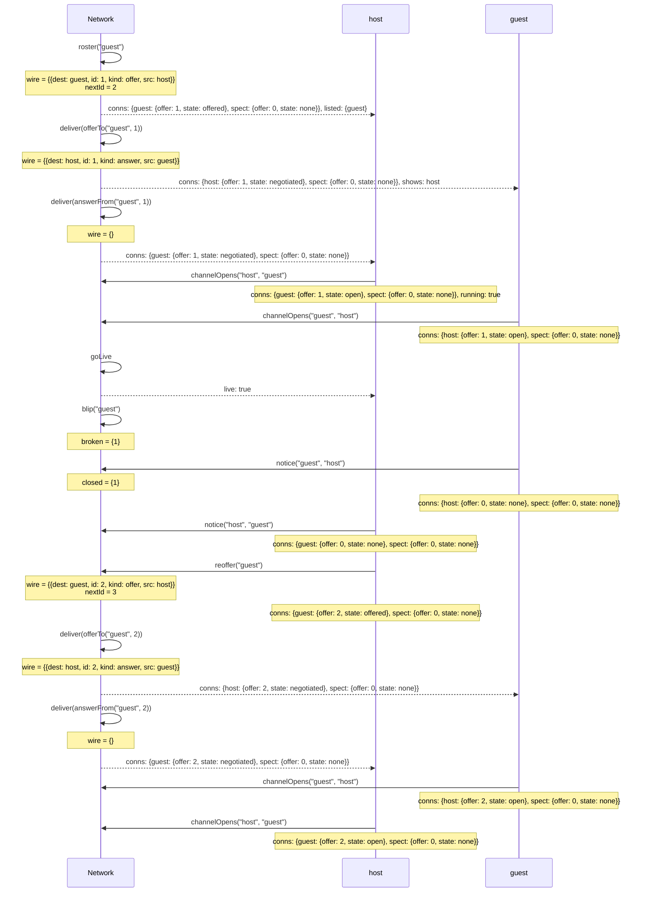

### guestStillHoldsTheOldConnectionTest

The drop again, but the host finds out first: the guest still holds the old connection, whose channel looks open on its page, when the host's deadline offers a new one. The offer names a newer connection than the guest's, so the guest closes its old one and answers from a new one, and the pair connects. Before the deadline nothing offered again.

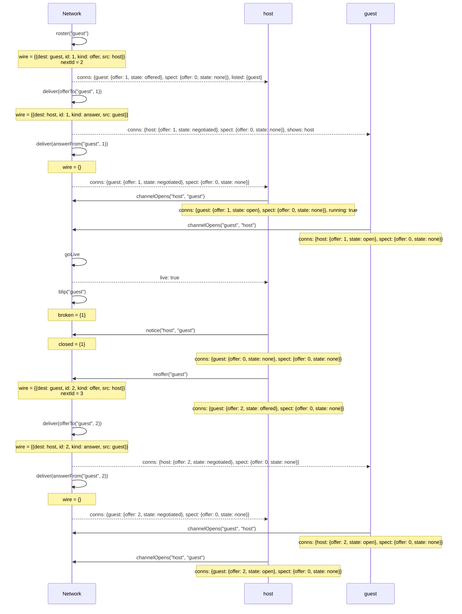
